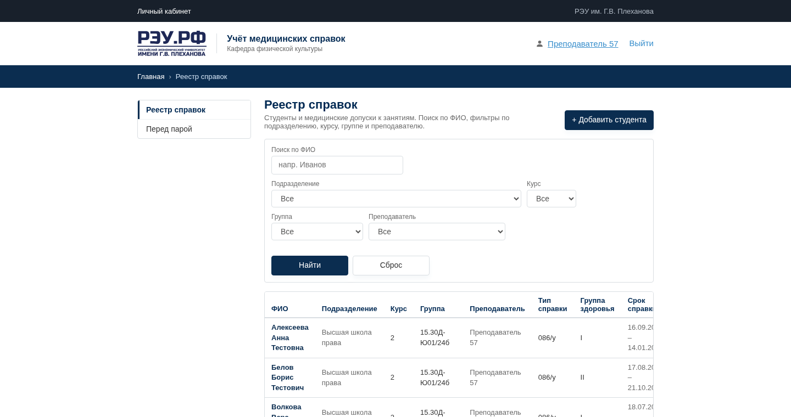
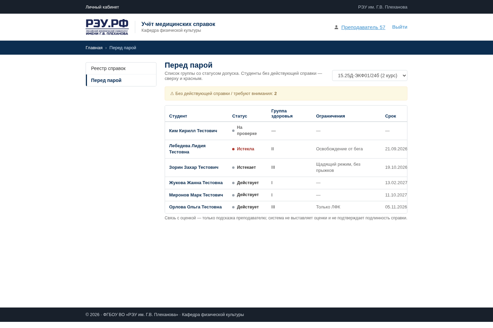
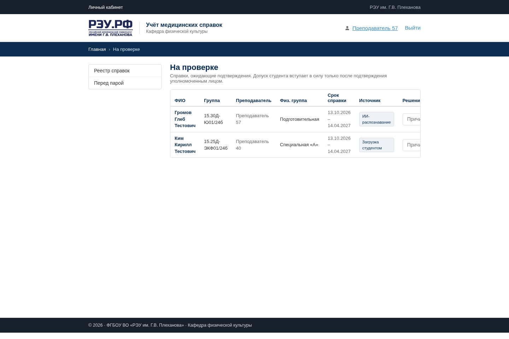
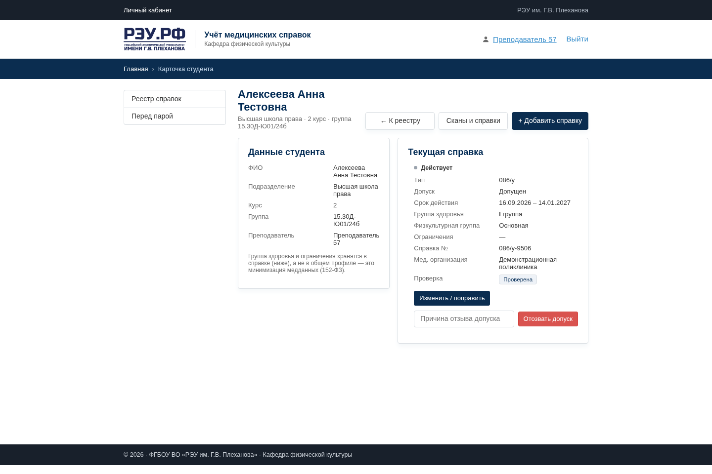

# MedSpravki REU

**[Русская версия →](README.ru.md)**

A student-built web registry based on a real brief from the Plekhanov Russian University of Economics physical education department to review medical certificates and class eligibility.



**Stack:** .NET 8 · C# 12 · ASP.NET Core Razor Pages · Entity Framework Core 8 · PostgreSQL 16 · local Ollama vision model · xUnit

Historical development and verification notes are kept in [docs/PROJECT-STATUS.md](docs/PROJECT-STATUS.md).

## What it does

- Searches and filters students by department, course, group, and teacher.
- Tracks certificate validity, health group, physical education group, restrictions, and review status.
- Builds a before-class list that puts students without a valid certificate first.
- Accepts PDF or image uploads and routes submissions to staff for review.
- Uses a local Ollama vision model to propose structured fields from a scan; a staff member confirms the result.
- Keeps certificate history and an audit log with separate student, teacher, department head, and administrator access.

| Before class | Review queue | Student card |
|---|---|---|
|  |  |  |

## How it works

```text
PDF or image → local Ollama vision model → structured draft → staff review → PostgreSQL record
```

The web app stores uploaded files outside the public web directory and treats recognition as a draft, not a decision. The `Manual` recognition provider keeps the registry usable without Ollama or a GPU.

## Run it

You need the .NET 8 SDK, Docker, and a free local port `5432`.

```bash
git clone https://github.com/Archangel-gabri/medspravki-reu.git
cd medspravki-reu/app

docker run --name reu-pg -d \
  -e POSTGRES_PASSWORD=postgres \
  -e POSTGRES_DB=reu_med_certificates \
  -p 5432:5432 postgres:16

ASPNETCORE_ENVIRONMENT=Development \
BootstrapUser__Enabled=false \
SeedDemoData=true \
DEMO_USER_PASSWORD='choose-a-local-demo-password' \
Recognition__Provider=Manual \
dotnet run --project src/ReuMedCertificates.Web --urls http://localhost:5080
```

Open `http://localhost:5080` and sign in as `teacher` with the password set in `DEMO_USER_PASSWORD`. The seeded students and certificates are synthetic demo records.

## Limits

- The official v1 requirements describe a manual registry. Student uploads, stored scans, and recognition are an extended student-project scope, not confirmed customer requirements.
- Recognition can misread handwritten fields and does not prove that a certificate is authentic. Human review is required.
- The repository has domain and application unit tests, but no integration tests, end-to-end suite, or CI workflow.
- The current import page reads from SQL or 1C OData. Excel import and export from the v1 requirements are not implemented.
- The screenshots contain synthetic demo records only. Real medical data requires an institution-controlled deployment and a separate privacy and security review.

## License

[MIT](LICENSE) © 2026 Vadim Kubrak.
